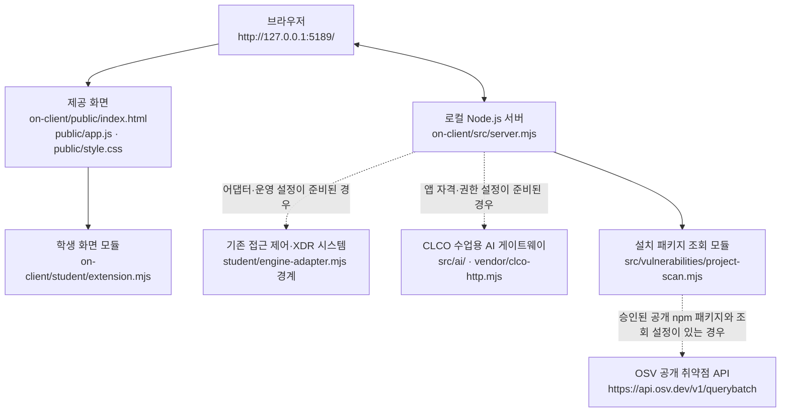

# 밍밍 보안 Agent 실행 설명서와 구성도

이 문서는 이 저장소의 현재 코드에서 확인할 수 있는 실행 방법과 구성 경계, 그리고 실제 확인 여부를 정리합니다. 문서에 적힌 코드 경로는 저장소 내 경로이며, 개인 PC의 절대 경로는 PC마다 다릅니다.

## 1. 목적과 지원 범위

밍밍은 직원 본인의 계정·기기·세션 상태, 업무 앱 접근 판정, 최근 보안 기록과 AI 사건 설명을 한 화면에서 확인하도록 구성된 보안 Agent 학습 프로젝트입니다. 학생이 구현하는 화면은 `student/extension.mjs`에 있습니다.

| 항목 | 현재 확인 가능한 범위 |
|---|---|
| 실행 환경 | Windows PowerShell과 Node.js. 시작 도구는 Node.js 22~24를 허용하며 수업 기준은 24.19.0입니다. |
| npm 의존성 | `package.json`에는 외부 npm 의존성이 선언돼 있지 않습니다. 별도 패키지 설치가 필요하다고 가정하지 않습니다. |
| 로컬 주소 | 기본 포트 5189의 `http://127.0.0.1:5189/` |
| 실행 확인 | 2026-10-26 작업 중 `npm run demo` 실행 후 브라우저가 열리는 것을 사용자가 확인했습니다. `npm run check`도 실행했고 문법 오류가 출력되지 않았습니다. |
| 확인하지 않은 것 | 이 기록만으로 실제 접근 제어/XDR 시스템, CLCO AI 게이트웨이, OSV 외부 조회 또는 운영 환경 연결을 확인한 것은 아닙니다. |

`package.json`의 `engines`는 Node.js `24.19.0`을 지정합니다. 시작 스크립트는 Node.js 22~24를 허용하고 24.19.0을 권장합니다. 이 문서를 작성하는 과정에서는 PC의 `node -v`와 `npm -v`를 새로 실행해 실제 설치 버전을 기록하지 않았습니다.

## 2. 저장소와 폴더 위치

Git 저장소 최상위에는 앱 폴더 `on-client/`가 있습니다. **앱 실행 명령은 `on-client` 폴더에서**, Git 커밋과 21·22단계 원문 제출 준비는 일반적으로 그 위의 저장소 최상위에서 진행합니다.

```text
mingming-On-client/                 # Git 저장소 최상위
└── on-client/                      # 앱 폴더: 실행 명령을 여기서 입력
    ├── .env.example                # 비밀값 없는 설정 견본
    ├── .on-starter-manifest.json   # 시작 틀 파일 목록·해시 정보
    ├── README.md                  # 시작 틀 안내
    ├── package.json               # 실행 스크립트와 Node.js 기준
    ├── docs/                       # 과제·실행·연결 안내
    ├── public/                     # 브라우저 화면과 제공 JavaScript/CSS
    ├── src/                        # 앱 서버와 서버 측 모듈
    ├── student/                    # 학생 화면 모듈과 연결 어댑터 경계
    ├── tools/                      # PowerShell 실행·설정 도구
    └── vendor/                     # 프로젝트가 포함한 외부 연동 코드
```

현재 GitHub의 `on-client/` 파일 목록에는 `package-lock.json`이 보이지 않습니다. OSV 패키지 조회는 별도 설정으로 지정된 프로젝트의 lock 파일과 설치 메타데이터를 확인해야 하므로, 현재 저장소의 이 목록만으로 OSV 조회 구성이 완료됐다고 판단하지 않습니다.

## 3. 실행 방법

### 3.1 준비

1. 파일 탐색기에서 앱 폴더 `on-client`를 엽니다.
2. 파일 탐색기의 주소 표시줄에 `powershell`을 입력하고 Enter를 눌러 그 위치에서 PowerShell을 엽니다.
3. Node.js가 설치돼 있는지 확인합니다. 프로젝트의 수업 기준 버전은 24.19.0입니다. 버전 확인 명령은 `node -v`이며, npm 버전 확인은 `npm -v`입니다.

### 3.2 권장 시작 명령

앱 폴더 `on-client`에서 실행합니다.

```powershell
powershell -NoProfile -ExecutionPolicy Bypass -File .\tools\start-alekov.ps1
```

실행 도구의 코드에는 다음 절차가 구현돼 있습니다.

- 앱 폴더와 필수 파일이 있는지 확인합니다.
- Node.js 버전과 기본 포트 5189의 사용 여부를 확인합니다.
- `src/server.mjs`를 실행하고 `http://127.0.0.1:5189/`에 서버가 응답하는지 확인합니다.
- 서버 응답 확인을 AI 또는 기존 회사 시스템 연결 성공으로 취급하지 않습니다.

시작 도구가 출력하는 정상 시작 신호는 다음과 같습니다. 이 문서 작성 시 시작 PowerShell 스크립트를 새로 실행해 메시지를 재검증한 것은 아닙니다.

```text
케셰브가 켜졌습니다. 브라우저에서 http://127.0.0.1:5189/ 을 여세요.
서버가 응답한 것만 확인했습니다. AI 연결 상태는 화면에서 따로 확인해 주세요.
```

앱의 개인 Agent 이름은 밍밍입니다. 제공 시작 도구와 일부 기본 화면 문구에는 시작 틀의 기본 이름인 케셰브가 남아 있을 수 있습니다. 이 문서는 제공 UI나 시작 도구를 변경하지 않습니다.

### 3.3 대체 실행 및 확인 명령

앱 폴더 `on-client`에서 사용할 수 있는 명령입니다.

| 명령 | 용도 | 주의 |
|---|---|---|
| `npm start` | 기본 서버 실행 | 기본 실행은 실제 기존 회사 시스템에 연결된 상태가 아닙니다. |
| `npm run demo` | 예제 자료로 화면 실행 | 예제 데이터이며 실제 시스템 연결이나 단계 통과를 뜻하지 않습니다. |
| `npm run check` | 학생 화면과 포장 도구의 JavaScript 문법 검사 | 실제 서버 연결·화면 통합·과제 채점은 검사하지 않습니다. |
| `npm run package-app` | 새 패키지 폴더, ZIP, APP_PACKAGE_MANIFEST.json, 바탕화면 바로가기 생성 | 작업 트리가 깨끗해야 하며 Windows PowerShell을 사용합니다. 인증·설정 파일은 포함하지 않습니다. |

시작 도구에서 기본 포트를 쓸 수 없다는 메시지가 나오면 다른 프로그램을 종료하지 말고, 앱 폴더에서 다음처럼 포트를 바꿔 실행합니다.

```powershell
powershell -NoProfile -ExecutionPolicy Bypass -File .\tools\start-alekov.ps1 -Port 5190
```

이 경우 브라우저 주소도 `http://127.0.0.1:5190/`으로 바꿉니다. 별도 포트를 사용하지 않았다면 기본 주소 `http://127.0.0.1:5189/`을 사용합니다.

### 3.4 종료와 재실행

- 포그라운드로 실행한 PowerShell 창에서 `Ctrl+C`를 눌러 서버를 종료합니다.
- 다시 실행할 때는 앱 폴더 `on-client`에서 3.2의 시작 명령을 다시 입력합니다.
- 실행 도구는 프로그램을 설치하거나 파일을 지우지 않습니다. 재실행 전 기존 학생 파일이나 Git 기록을 지울 필요가 없습니다.

### 3.5 실제 SDP 연결

기본 실행은 연결 없는 상태입니다. 실제 계정·기기·접속 판정·보안 기록을 조회하려면 담당 운영자가 발급한 SDP 호스트 설정 파일의 경로를 실행 옵션으로 지정해야 합니다. 설정 파일의 내용이나 개인 인증 자료를 프로젝트, Git, 채팅, 제출물에 복사하지 않습니다.

```powershell
powershell.exe -NoProfile -ExecutionPolicy Bypass -File .\tools\start-alekov.ps1 -Port 5191 -SdpHostConfig "C:\운영자가_발급한_실제_경로\sdp-host.json"
```

위 경로는 설명용 자리표시자이며 그대로 실행하면 안 됩니다. 담당자에게 실제로 발급받은 절대 경로로 바꿉니다. 계정 연결·AI 승인을 위한 native 설정은 별도이며 SDP 설정을 대신하지 않습니다. 설정을 발급받지 못했다면 연결된 것처럼 표시하거나 예제 데이터를 실제 기록으로 섞지 말고 담당 운영자에게 발급 여부를 확인합니다.

기록·기기·세션은 연결 모드만으로 성공으로 판정하지 않습니다. 해당 API의 이번 응답이 정상이고 데이터 계약 검증을 통과한 경우에만 조회된 결과로 취급합니다. unknown, 오류, 미조회는 정상·안전 또는 빈 결과가 아닙니다.

## 4. 시스템 구성도

아래 구성은 소스 코드에 나타나는 모듈과 연결 경계를 설명합니다. 화살표는 가능한 데이터 흐름이며 모든 외부 시스템 연결이 현재 설정돼 있다는 뜻은 아닙니다.



### 데이터 흐름

1. 브라우저가 로컬 앱 서버에서 `public/index.html`, `public/app.js`, `public/style.css`와 학생 모듈 `student/extension.mjs`를 읽습니다.
2. 제공 화면은 동일한 로컬 서버의 API를 호출합니다. 현재 화면 코드에는 `/api/me`, `/api/apps`, `/api/access`, `/api/events`, `/api/ai/explain`, `/api/vulnerabilities` 등의 경로가 정의돼 있습니다.
3. 기존 접근 제어/XDR 시스템 연결은 엔진 어댑터와 실행 환경의 연결 설정에 달려 있습니다. 기본 실행의 엔진 상태는 `disconnected`입니다.
4. 앱 안 AI 설명 요청은 로컬 서버를 거쳐 서버 측 AI 모듈에 전달됩니다. 앱 자격, 신원 매핑, 권한 및 게이트웨이 설정이 준비되지 않았다면 실제 AI 설명 성공으로 간주할 수 없습니다.
5. 설치 패키지 조회는 서버 측 `src/vulnerabilities/project-scan.mjs`와 `src/vulnerabilities/osv.mjs`를 사용합니다. 담당자가 승인한 공개 패키지만 OSV로 조회하며, 비공개 패키지 이름이나 로컬 경로를 외부 조회로 보내지 않습니다.

## 5. 제공 코드와 학생 구현 경계

| 경로 또는 함수 | 역할 | 작업 경계 |
|---|---|---|
| `public/index.html`, `public/app.js`, `public/style.css` | 제공 화면, 사용자 조작, API 호출 및 학생 렌더러 호출 | 학생 단계에서 임의 수정하지 않음 |
| `src/server.mjs`, `src/engine.mjs`, `src/connection/` | 로컬 API 서버와 서버·엔진 연결 경계 | 제공 코드; 운영 연결을 임의로 구성하지 않음 |
| `src/ai/`, `vendor/clco-http.mjs` | 서버 측 AI 연결·응답 처리 | 실제 앱 자격과 권한 설정은 담당자 안내에 따름 |
| `src/vulnerabilities/` | lock 파일·설치 메타데이터를 대조하고 OSV 응답을 정규화 | 승인 목록과 프로젝트 경로가 준비되지 않으면 조회 성공을 주장하지 않음 |
| `tools/start-alekov.ps1` | 앱 폴더·Node.js·포트 확인 후 서버 실행 | 실행 환경을 확인하는 도구이며 외부 연결을 승인하지 않음 |
| `student/extension.mjs` | 학생이 작성하는 표시 함수 | 13~20단계에서 아래 렌더러를 구현 |
| `student/engine-adapter.mjs` | 담당자가 제공하는 기존 시스템 어댑터 연결 경계 | 개인 비밀값을 코드로 넣지 않음 |

현재 학생 렌더러 함수는 다음과 같습니다.

| 함수 | 화면 역할 |
|---|---|
| `renderIdentity` | 계정, 현재 기기, 세션 상태 |
| `renderDecision` | 업무 앱 접근 판정과 이유 |
| `renderEvents` | 최근 보안 기록과 상세 내용 |
| `renderStatus` | 기기·세션·연결 알림과 상태 |
| `renderAiConnection` | 앱 안 AI 연결 점검 결과와 오류 안내 |
| `renderExplanation` | 사건 요약, 근거·규칙, 확인 불가 상태 및 조치 제안 |
| `renderAction` | 조치 준비·접수·처리 상태와 실제 효과 확인 결과 구분 |
| `renderVulnerabilities` | 패키지 버전, OSV 조회 상태, 취약점 ID와 수정 시각 |

학생 렌더러는 표시용 함수입니다. 조치 준비·사람 확인·집행·연동 시스템 결과 재조회는 제공 화면의 흐름에서 수행하며, 학생 표시 함수에 새로운 POST 요청이나 확인 티켓 보관 로직을 추가하지 않습니다.

## 6. 설정 파일과 OSV 조회 범위

`on-client/.env.example`은 비밀값 없는 설정 견본입니다. 현재 견본에는 아래 값이 있습니다.

- `ON_PORT=5189`
- `ON_ENGINE_ADAPTER=./student/engine-adapter.mjs`
- `ON_AI_MODEL=aleph/auto`
- `ON_PROJECT_DIRECTORY=`
- `ON_APPROVED_PUBLIC_PACKAGES=[]`

이 파일은 견본이며 자동으로 적용된다고 가정하지 않습니다. OSV 조회에는 담당자가 준비한 프로젝트 경로와 공개 패키지 승인 목록이 필요합니다. 현재 견본의 경로는 비어 있고 승인 목록도 빈 배열입니다. 따라서 이 견본만으로 실제 패키지 조회가 설정됐다고 말할 수 없습니다.

- `complete`: 조회 대상에 대한 조회가 완료됨
- `partial`: 일부 조회를 확인하지 못했으며 이미 확인한 결과를 보존
- `not_checked`: 승인된 공개 조회 대상이 없어 조회하지 않음
- `not_configured`: 프로젝트 경로 설정이 없음
- `unverifiable`: lock 파일이나 전체 조회를 확인할 수 없음

패키지별 `none_found`는 조회 범위에서 알려진 취약점이 발견되지 않았다는 의미입니다. 취약점 데이터베이스의 부재나 조회 실패는 “안전”의 증거가 아니며 앱 전체의 안전성을 보장하지 않습니다. 학생은 취약점을 만들기 위해 의존성을 낮추거나 허용 목록·프로젝트 경로를 임의 변경하지 않습니다.

## 7. 오류가 생겼을 때

| 메시지·상태 | 의미와 확인 순서 |
|---|---|
| `Node.js 가 없습니다` | Node.js 24.19.0 설치 후 새 PowerShell 창에서 다시 실행합니다. |
| `지금 Node.js 는 vXX 입니다` | 시작 도구의 지원 범위는 22~24입니다. 수업 기준 24.19.0을 권장합니다. |
| `포트 5189 를 다른 프로그램이 쓰고 있습니다` | 그 프로그램을 종료하지 말고 3.3처럼 `-Port 5190`을 사용하고 주소도 바꿉니다. |
| `앱 폴더가 아닙니다` 또는 `시작 틀 폴더가 아닙니다` | `on-client` 폴더에서 시작 명령을 실행했는지 확인합니다. |
| `앱 서버가 ... 초 안에 뜨지 않았습니다` | 실행 창의 전체 메시지를 담당 강사에게 보여 줍니다. 연결 비밀값을 복사해 보내지 않습니다. |
| AI 연결이 준비 중이거나 확인 불가 | 서버가 실행된 사실과 AI 연결을 구분합니다. 화면의 오류 코드와 `docs/CONNECTION_TROUBLESHOOT.md`를 확인하고 담당자 안내를 따릅니다. |
| 기존 서버 연결 없음 | 기본 실행에서는 정상적으로 나타날 수 있습니다. 실제 연결 어댑터·설정은 담당자가 준비해야 합니다. |
| OSV가 `not_configured` 또는 `not_checked` | 프로젝트 경로와 공개 패키지 허용 목록의 운영 설정이 필요한지 담당자에게 확인합니다. 의존성을 낮추거나 비공개 패키지 이름을 외부에 보내지 않습니다. |
| OSV가 `partial` 또는 `unverifiable` | 전체 결과를 깨끗하다고 판단하지 않습니다. 화면에 남은 취약점 ID를 보존하고 조회 확인 불가 상태로 취급합니다. |

추가 연결 오류는 [연결과 문제 해결 안내](CONNECTION_TROUBLESHOOT.md)와 담당자에게서 받은 [SDP 연결 안내](SDP_HOST_CONNECTION.md)를 참고합니다. 설정 파일, 인증서, 개인키, 토큰, 비밀번호는 문서·채팅·커밋·캡처에 넣지 않습니다.

## 8. 확인 기록과 미확인 범위

| 확인 항목 | 기록 |
|---|---|
| `npm run demo`로 로컬 화면 열기 | 2026-10-26 작업 중 사용자가 화면이 열렸다고 확인함. 이번 문서 커밋 이후 다시 실행한 것은 아님. |
| `npm run check` | 2026-10-26 실행 결과에 문법 오류 출력이 없음. 이 명령은 학생 모듈의 문법만 검사함. |
| 시작 PowerShell 스크립트의 최신 실행 | 이번 문서 작성 과정에서는 다시 실행하지 않음. 정상 메시지는 소스 코드에서 확인함. |
| 새 PowerShell 창에서 이 문서만 따라 재실행 | 미확인. |
| 실제 접근 제어/XDR 연결과 계정별 접근 | 미확인. |
| 실제 앱 AI 연결·유료 생성 호출 | 이 문서 작성 과정에서 실행하지 않음. 미확인. |
| 실제 OSV 외부 조회와 학생 프로젝트 패키지 대조 | 미확인. |
| 21단계 원문 제출 및 공식 AI 판정 | 실행하지 않음. 미확인. |

## 9. 21·22단계 제출 시 주의

21·22단계는 ALEPH 과제 화면에서 저장소 주소와 40자리 커밋을 직접 지정하는 방식으로 안내됩니다. 비공개 저장소라면 해당 단계 화면의 「비공개 저장소 원문 준비 방법」과 「원문 전달 도구 받기」를 사용합니다.

원문 전달 도구는 프로젝트 밖에 압축 해제하고, JSON 결과도 프로젝트 밖의 새 폴더에 저장합니다. PowerShell 명령의 구체적인 도구·경로 인수는 포털이 제공한 현재 안내를 그대로 따르고, 실제 PC 경로와 제출할 40자리 커밋을 확인한 뒤 실행합니다. 이 문서에서는 실제 경로와 커밋이 확인되지 않았으므로 명령을 추측해 적지 않습니다. 원문 전달 완료와 AI 검토 통과는 서로 다른 상태입니다.
